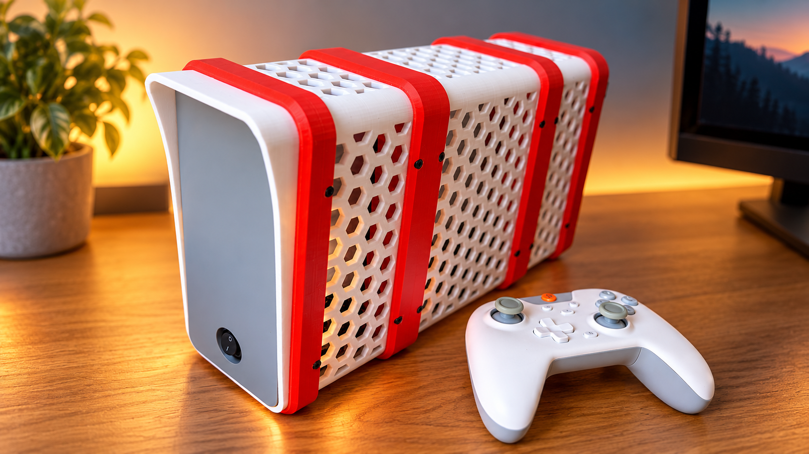
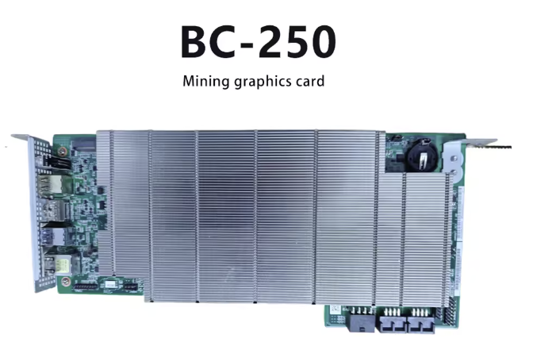
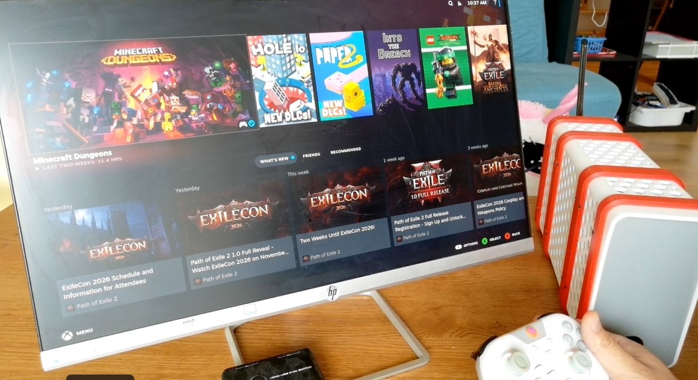
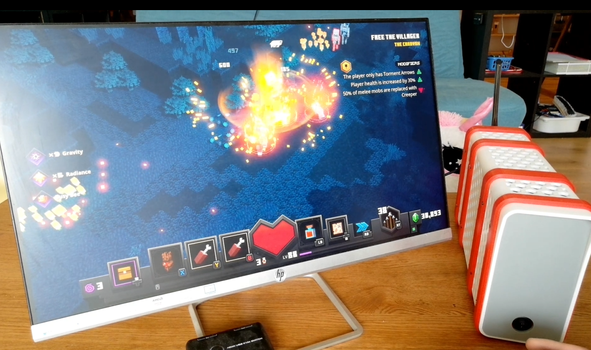

# Gaming PC Setup with BC 250

  
   
  <a href="https://youtu.be/GZjAGjzqiRY">▶ Watch the video on YouTube</a>

Computers are expensive these days. Gaming PCs are worse, because a gaming PC needs a graphics card, and a graphics card with a decent amount of memory now costs about as much as a used car (a small one, but still).
Is it fair to blame the system? Probably. My entire generation grew up wanting to play games, and just when I finally thought I could afford a proper gaming PC, the dream quietly drifted away.

Then I found the BC-250.

When you order one, you get a big slab of PCB, roughly the size of a large graphics card. It doesn't look like a PC at all. It looks like a green board covered in metal that fell off a server rack, which is more or less what it is. And it was cheap: around 160 USD. Well... I just checked again, and it's now about 350 USD. Hmm. Sorry, folks.
I'm going to pretend it's still cheap and carry on in this tone.

Despite its looks, the BC-250 is a complete computer on a single board: a CPU and GPU (technically one APU), memory, and the essential ports (USB, DisplayPort, Ethernet). The chip inside is a cousin of the one in the **PlayStation 5**.
Add an NVMe SSD, a power supply, and a few accessories, and you have a machine that plays games with genuinely decent graphics.
Honestly, it's a lucky time to be a nerd. (Or anyone stubborn enough to build a PC from a mining board.)

This repo covers how I built mine, plus the 3D-printable enclosure design files. I hope you enjoy it.

> **TL;DR**: The BC-250 is a PS5-class APU on a bare board for the price of a mid-range graphics card (or a few games, back when it was cheap). It runs Linux games at 1080p nicely. It does **not** run Windows.

---

## Contents

1. [What is the BC-250?](#what-is-the-bc-250)
2. [What it can and can't do](#what-it-can-and-cant-do)
3. [Bill of Materials](#bill-of-materials)
4. [Printing the Enclosure](#printing-the-enclosure)
5. [Assembly](#assembly)
6. [Software Setup](#software-setup)
7. [Troubleshooting](#troubleshooting)
8. [Share Your Build](#share-your-build)
9. [Support](#support)

---

## What is the BC-250?

The BC-250 is a compute "blade" made by ASRock Rack for crypto mining. Each board carries a cut-down version of the **AMD APU used in the PlayStation 5**. After the mining boom ended, thousands of these boards were sold off cheaply, and the Linux community has turned them into capable little gaming machines.

|                |                                                                  |
| -------------- | ---------------------------------------------------------------- |
| **CPU**        | 6-core / 12-thread AMD Zen 2                                     |
| **GPU**        | AMD RDNA 2-based integrated graphics (24 CUs)                    |
| **Memory**     | 16 GB GDDR6, **shared** between CPU and GPU                      |
| **Storage**    | 1× M.2 2280 NVMe slot                                            |
| **Video out**  | 1× DisplayPort                                                   |
| **Networking** | Gigabit Ethernet (no Wi-Fi / Bluetooth)                          |
| **Power**      | 12 V via PCIe power connector                                    |
| **Cooling**    | Large passive heatsink, so it **needs a fan blowing through it** |

The board was never meant to be a desktop. It has no case, no fan, no Wi-Fi and only a few ports. This project adds what's missing.

---

## What it can and can't do

### ✅ What you can do

- **Play games on Linux**: Steam + Proton runs a large part of the Windows game library. Expect roughly **1080p at medium-to-high settings** in many titles.
- **Emulation**: it handles retro consoles up through the PS2/GameCube/Switch era comfortably.
- **Living-room / couch PC**: with Bazzite or SteamOS-style "Big Picture" mode, it works like a console.
- **Game streaming host**: use Steam Remote Play or Sunshine/Moonlight to stream to other devices.
- **Home server / tinkering box**: the 16 GB of fast memory and 6 cores make it a strong low-cost Linux machine. It can also run small local AI models through Vulkan.

### ❌ What you can't do

- **No Windows.** There are no working Windows GPU drivers for this chip. You'll get a basic display at best and no 3D acceleration. **Plan on Linux only.**
- **No kernel anti-cheat games.** Titles like Valorant, Fortnite, Call of Duty, and some others block Linux entirely. Check [areweanticheatyet.com](https://areweanticheatyet.com) before you buy.
- **No GPU upgrades.** There is no PCIe slot, so the graphics are what they are.
- **No onboard Wi-Fi, Bluetooth, or audio jack.** Audio goes through DisplayPort/HDMI to your monitor or TV (or use a USB sound card). Wi-Fi comes from a USB adapter (see BOM).
- **Limited ports.** One display output and very few USB ports, so a USB hub is part of the build.
- **Not plug-and-play.** Expect some Linux setup, and possibly a BIOS update to unlock memory settings. It's a tinkerer's machine.

---

## Bill of Materials

### Electronics

| #   | Part                                             |  Qty  | Notes                                                                                               | Link                                                                             |
| --- | ------------------------------------------------ | :---: | --------------------------------------------------------------------------------------------------- | -------------------------------------------------------------------------------- |
| 1   | **AMD BC-250 board**                             |   1   | Usually sold used on eBay / AliExpress                                                              | —                                                                                |
| 2   | **Power supply**: METALFISH Flex 300W            |   1   | Small Flex-ATX PSU; must provide a PCIe 8-pin (6+2) connector                                       | [AliExpress](https://aliexpress.com/item/10000289980196.html)                    |
| 3   | **Fan**: ARCTIC P12 Max 120 mm                   |   1   | High static pressure, pushes air through the heatsink                                               | [AliExpress](https://it.aliexpress.com/item/1005009958824744.html)               |
| 4   | **NVMe SSD**, M.2 2280                           |   1   | 256 GB minimum, 1 TB+ recommended for games                                                         | —                                                                                |
| 5   | **USB hub**: Acer 5-port USB 3.0, 60 cm cable    |   1   | Adds ports for keyboard, mouse, controller, Wi-Fi                                                   | [Amazon](https://www.amazon.it/dp/B0CN3F9Y1Z)                                    |
| 6   | **USB Wi-Fi**: TP-Link Archer T3U Plus (AC1300)  |   1   | Optional if you use the Ethernet port                                                               | [Amazon](https://www.amazon.it/TP-Link-Archer-T3U-Plus-Adattatore/dp/B0859M539M) |
| 7   | **DisplayPort → HDMI cable**                     |   1   | Only needed for HDMI TVs/monitors. Use an *active* cable for 4K or HDR                              | —                                                                                |
| 8   | **19 mm rocker switch** (or ATX power-on jumper) |   1   | The BC-250 has no ATX connector, so the PSU needs this to turn on (see [Assembly](#4-power-supply)) | —                                                                                |

### Hardware

| #   | Part                                            |      Qty      | Notes                                               |
| --- | ----------------------------------------------- | :-----------: | --------------------------------------------------- |
| 9   | **M3 × 5 mm hex socket screws** (DIN 912)       | <!-- TODO --> | Join the printed parts                              |
| 10  | **M3 heat-set inserts**, OD 4.5 mm, length 3 mm | <!-- TODO --> | Melted into the printed parts with a soldering iron |

### Tools

- 3D printer with a print bed of at least **~210 × 210 mm** (designed on a Bambu Lab P1S)
- Soldering iron with a heat-set insert tip (or a spare conical tip)
- 2.5 mm hex key
- Phillips screwdriver (for the M.2 SSD screw)

---

## Printing the Enclosure

All files are in the [`STL/`](STL/) folder:

| File                                                   | Use                                                                                                   |
| ------------------------------------------------------ | ----------------------------------------------------------------------------------------------------- |
| [`p1s.3mf`](STL/p1s.3mf)                               | **Ready-to-print Bambu Studio project** with all parts arranged and settings applied. Easiest option. |
| `*.stl`                                                | Individual parts for any slicer                                                                       |
| [`BC 250 Enclosure.f3d`](STL/BC%20250%20Enclosure.f3d) | Fusion 360 source file if you want to modify the design                                               |

### Parts list

| Part                 | Size (mm)        |  Qty  |
| -------------------- | ---------------- | :---: |
| `Front Panel.stl`    | 91 × 5 × 185     |   1   |
| `Front Hood.stl`     | 99 × 25 × 193    |   1   |
| `Front Face.stl`     | 109 × 20.5 × 203 |   1   |
| `Cover Front.stl`    | 99 × 79 × 193    |   1   |
| `Fan Wall Front.stl` | 109 × 30 × 203   |   1   |
| `Cover Fan.stl`      | 99 × 138 × 193   |   1   |
| `Fan Wall Back.stl`  | 109 × 30 × 203   |   1   |
| `Cover Back.stl`     | 99 × 79 × 193    |   1   |
| `Back Face.stl`      | 109 × 30 × 203   |   1   |

### Recommended settings

These are the settings saved in `p1s.3mf`:

| Setting             | Value                                                |
| ------------------- | ---------------------------------------------------- |
| Layer height        | 0.12 mm (0.2 mm works too if you want faster prints) |
| Walls               | 2                                                    |
| Top / bottom layers | 5 / 5                                                |
| Infill              | 15 % gyroid                                          |
| Supports            | Tree (auto)                                          |
| Brim                | Auto                                                 |
| Bed                 | Textured PEI                                         |

> **💡 Material tip:** The project uses PLA+, which works for most of the case. The BC-250 heatsink gets hot under load, and PLA starts to soften around 55–60 °C. If you game for long sessions or the case sits in a warm spot, print the parts closest to the heatsink (fan walls and covers) in **PETG or ASA**.

---

## Assembly

> ⚠️ **Before you start:** Work on a clean, non-static surface, keep the PSU unplugged until the last step, and **never power the BC-250 without the fan running**. The heatsink is passive and the chip will overheat within minutes.

### 1. Install heat-set inserts

1. Heat the soldering iron to about **200–220 °C** for PLA (230–250 °C for PETG/ASA).
2. Set each insert on its hole and gently press it straight down until it's flush with the surface. Let the iron do the work and don't force it.
3. Let the parts cool fully before putting screws in.

### 2. Prepare the BC-250

1. Install the **NVMe SSD** in the M.2 slot and secure it with its screw.
2. *(Optional, recommended)* If the board is old or used, replace the thermal paste or pads under the heatsink. Mining boards often have dried-out paste.

### 3. Mount the fan

1. Fit the **ARCTIC P12 Max** into the fan wall, with the airflow arrow pointing **into the heatsink fins**.
2. Route the fan cable to the board's fan header, or to the PSU with a fan adapter.

### 4. Power supply

The BC-250 only takes 12 V through a PCIe power connector. It has no 24-pin ATX connector, so nothing ever tells the PSU to turn on. A normal motherboard does this by connecting the `PS_ON` wire (green) to ground (any black wire). We have to do that job ourselves.

#### Finding the right pins

On the 24-pin connector, `PS_ON` is **pin 16**, and it's the only **green** wire, so it's easy to spot. The pins on either side of it in the same row (**pin 15** and **pin 17**) are both ground (black), so use either one. That's the same pair people bridge with a paperclip when testing a PSU.

|  Pin  | Signal       | Wire colour |     |  Pin  | Signal     | Wire colour |
| :---: | ------------ | ----------- | --- | :---: | ---------- | ----------- |
|   1   | +3.3 V       | Orange      |     |  13   | +3.3 V     | Orange      |
|   2   | +3.3 V       | Orange      |     |  14   | −12 V      | Blue        |
|   3   | GND          | Black       |     |  15   | **GND**    | **Black**   |
|   4   | +5 V         | Red         |     |  16   | **PS_ON**  | **Green**   |
|   5   | GND          | Black       |     |  17   | **GND**    | **Black**   |
|   6   | +5 V         | Red         |     |  18   | GND        | Black       |
|   7   | GND          | Black       |     |  19   | GND        | Black       |
|   8   | PWR_OK       | Grey        |     |  20   | (not used) | —           |
|   9   | +5 V standby | Purple      |     |  21   | +5 V       | Red         |
|  10   | +12 V        | Yellow      |     |  22   | +5 V       | Red         |
|  11   | +12 V        | Yellow      |     |  23   | +5 V       | Red         |
|  12   | +3.3 V       | Orange      |     |  24   | GND        | Black       |

  
   
  24-pin ATX pinout diagram. Image: <a href="https://commons.wikimedia.org/wiki/File:ATX_PS_signals.svg">Wikimedia Commons</a>

> 💡 Wire colours are a convention, not a law. Some budget or flat-cable PSUs use all-black wires. In that case, go by **pin position**: find the latch, count to pin 16, and confirm with a multimeter. With the PSU plugged in but off, pin 16 should read about **3–5 V** against ground.

More references:
- [Wikipedia: ATX power supply pinout](https://en.wikipedia.org/wiki/ATX#Power_supply): full pinout table and connector history
- [Wikimedia Commons: photo of a 24-pin ATX plug](https://commons.wikimedia.org/wiki/File:24-pin_ATX_power_plug_from_a_Seasonic_PSU_20131105.jpg): useful for matching what's in your hand

**The quick way: a jumper.** Plug an ATX power-on jumper into the 24-pin connector. The PSU then runs whenever it's plugged into the wall, and you turn the PC on and off at the PSU's own switch or a power strip.

**The nicer way: a rocker switch (what I did).** This gives the case a proper power switch:

1. With the PSU **unplugged from the wall**, cut the **green (`PS_ON`)** wire and one **black (ground)** wire coming out of the 24-pin connector. Leave enough length to reach where the switch will be mounted.
2. Connect the two wires to the two terminals of a **19 mm rocker switch** (solder them, or use crimp spade connectors), and cover the joints with heat-shrink.
3. Mount the switch in the enclosure.

How it works:

- **Switch ON**: the green and black wires are connected (shorted), so the PSU turns on and powers the board.
- **Switch OFF**: the circuit is open, so the PSU goes into standby and stops supplying power.

> ⚠️ Only cut wires on the **low-voltage 24-pin side**. Never open the PSU itself; the capacitors inside can hold a dangerous charge even when it's unplugged. You can tie off or tape up the unused 24-pin connector and its remaining wires so they don't rattle around the case.

Then finish the power setup:

1. Connect the PSU's **PCIe 8-pin** cable to the BC-250.
2. Mount the PSU in the enclosure.

### 5. Connect peripherals

1. Plug the **USB hub** into the board, then plug the **Wi-Fi adapter**, keyboard, mouse, and controller into the hub.
2. Connect the **DisplayPort** (or DP → HDMI) cable to your monitor or TV.
3. Plug in Ethernet if you're using it.
4. Power on. The fan should spin up immediately.

### 6. Close up the enclosure

1. Assemble the printed sections from front to back:
   `Front Panel` → `Front Hood` → `Front Face` → `Cover Front` → `Fan Wall Front` → `Cover Fan` → `Fan Wall Back` → `Cover Back` → `Back Face`
2. Screw the sections together with the **M3 × 5 mm** screws.
3. Make sure no cables touch the fan blades and that the heatsink intake and exhaust are unobstructed.

---

## Software Setup

Because the BC-250 is Linux-only, the OS matters. These work well:

| Distro                                              | Good for                                                                       |
| --------------------------------------------------- | ------------------------------------------------------------------------------ |
| **[Bazzite](https://bazzite.gg)**                   | Console-like "boot straight into Steam" experience. Easiest choice for gaming. |
| **[Fedora Workstation](https://fedoraproject.org)** | General desktop use plus gaming                                                |
| **[CachyOS](https://cachyos.org)**                  | Performance-tuned Arch-based distro                                            |

### Steps

1. **Flash the installer** to a USB stick with [Fedora Media Writer](https://fedoraproject.org/workstation/download) or [balenaEtcher](https://etcher.balena.io).
2. **Boot and install** to the NVMe SSD.
3. **Update the system** right away. You need a recent kernel and **Mesa 25.1 or newer** for proper GPU support.
4. **(Recommended) Update the BIOS**: a community BIOS lets you change how much of the 16 GB is reserved for the GPU and unlocks other settings.
5. **(Recommended) Install a GPU clock governor**: by default the GPU runs at a fixed clock. A governor lets it scale up and down, which lowers idle power, heat, and noise.
6. **Install Steam**, enable **Proton** for all titles (*Settings → Compatibility*), and start gaming.

📚 For BIOS files, the GPU governor, and the latest tweaks, see the community docs: **[mothenjoyer69/bc250-documentation](https://github.com/mothenjoyer69/bc250-documentation)**

---

## Troubleshooting

| Problem                                          | Likely cause / fix                                                                                                                          |
| ------------------------------------------------ | ------------------------------------------------------------------------------------------------------------------------------------------- |
| Nothing happens when powered on                  | PSU isn't turning on. Check the ATX power-on jumper and the PCIe cable.                                                                     |
| No display                                       | Try a different DP cable. Some DP → HDMI cables need to be *active*. Confirm the monitor is on the right input.                             |
| Black screen or no 3D acceleration after install | Mesa is too old. Update the system, or use a distro with Mesa 25.1+.                                                                        |
| System shuts down under load                     | Overheating. Check that the fan spins and points into the heatsink, and that the vents aren't blocked.                                      |
| Games stutter or run out of memory               | Too little memory reserved for the GPU. Adjust the VRAM split in the community BIOS.                                                        |
| Game won't launch at all                         | Check [ProtonDB](https://www.protondb.com) for that title and [areweanticheatyet.com](https://areweanticheatyet.com) for anti-cheat issues. |

---

## Share Your Build

Built one? I'd love to see it. Post photos of your build, your print colours, your cable management (or the lack of it, no judgement), and your benchmark numbers over at **[r/unkyulee](https://www.reddit.com/r/unkyulee/)**.

Questions, improvements, and "I accidentally made it better" remixes are all welcome there too.

---

## Support

This project came together through a lot of small experiments: reprinted enclosure parts, rewired power switches, Linux tweaks at odd hours, and a fair amount of coffee.

If this guide helped you build your own BC-250 gaming PC, saved you from buying a graphics card that costs as much as a used car, or just made for a fun weekend project, you can support future builds by buying me a coffee. 

It helps me keep experimenting, documenting, and sharing everything openly, including the design files.

  <a href="https://www.buymeacoffee.com/unkyulee"><strong>☕ Buy me a coffee</strong></a>

---

*Have fun, and happy gaming!*
— Un Kyu Lee